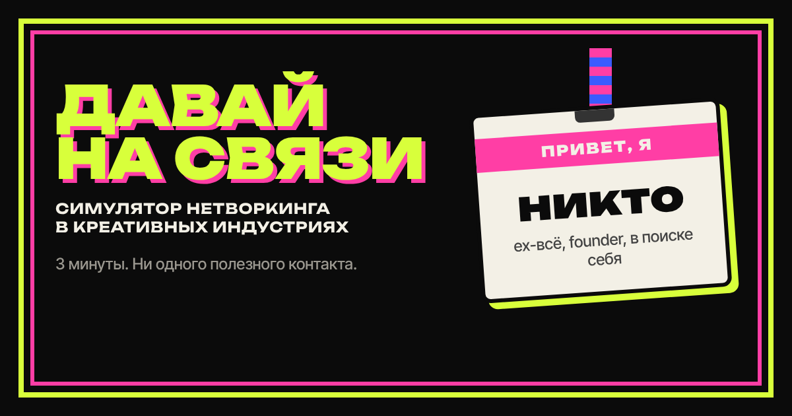

# ДАВАЙ НА СВЯЗИ

**Симулятор нетворкинга в креативных индустриях.** 3 минуты. Ни одного полезного контакта.

Ты приходишь на вернисаж, афтепати фестиваля, форум креативных индустрий, презентацию коллабы, премьеру, день рождения арт-директора,
демонтаж после ивента, закрытый ужин креативных директоров, креаторский митап, сходку админов телеграм-каналов или фестиваль медиа-арта.
Люди в бейджах говорят тебе вещи. Ты отвечаешь. Батарейка садится, кринж растёт, клаут колеблется.
В конце — архетип, приговор в одну строку и карточка, которую стыдно и приятно переслать коллегам.

👉 **Играть:** https://youngtyuni.github.io/davai-na-svyazi/



## Что внутри

- 10 ролей: дизайнер, ивент-менеджер, музыкант, художник, продюсер, креативный директор, фотограф, контент-креатор, автор телеграм-канала, медиа-художник.
- 11 ивентов, 173 встречи, 521 реплика, каждый забег — 8 случайных.
- 3 шкалы: 🔋 батарейка, 😬 кринж, ✨ клаут. Контакты делятся на тех, кто напишет, и тех, кто «напишет на неделе».
- 11 финалов, 16 ачивок, кнопка «Уйти по-английски» на каждом экране.
- Шер-карточка PNG и текст в стиле Wordle. Без регистрации, без бэкенда, без аналитики.

## Запуск

Никакой сборки. Открой `index.html` в браузере или задеплой на GitHub Pages:

```bash
git clone https://github.com/youngtyuni/davai-na-svyazi.git
cd davai-na-svyazi
python3 -m http.server 8080
```

Для GitHub Pages: Settings → Pages → Source: **GitHub Actions**. Workflow уже в репозитории, деплой при пуше в `main`.

## Проверки

```bash
node tools/validate.js --prod   # схема контента, лимиты длины, флаги, дубли
node tools/engine.test.js       # 171 юнит-тест движка
node tools/simulate.js 500      # распределение финалов при случайной игре
node tools/strategies.js        # жадные стратегии по ивентам: достижимость каждого финала
node tools/e2e.js               # Playwright-прогон на 390×844, скриншоты, ошибки консоли
```

## Добавить свою историю

Самое ценное в игре — узнаваемые ситуации. Если у тебя есть своя, см. [CONTRIBUTING.md](CONTRIBUTING.md): одна встреча — один пул-реквест, 5 минут.

## Как это сделано

Игра собрана командой агентов с ролями: ресёрчеры по секторам, сценаристы по ивентам, редактор юмора,
фронтенд-инженер, QA-плейтестер. Стратегия, пайплайн и критерии успеха — в [`docs/STRATEGY.md`](docs/STRATEGY.md),
правила игры — в [`docs/GAME_DESIGN.md`](docs/GAME_DESIGN.md), определения агентов — в [`.claude/agents/`](.claude/agents/).

## Лицензия

MIT. Все персонажи вымышлены. Все ситуации — нет.
